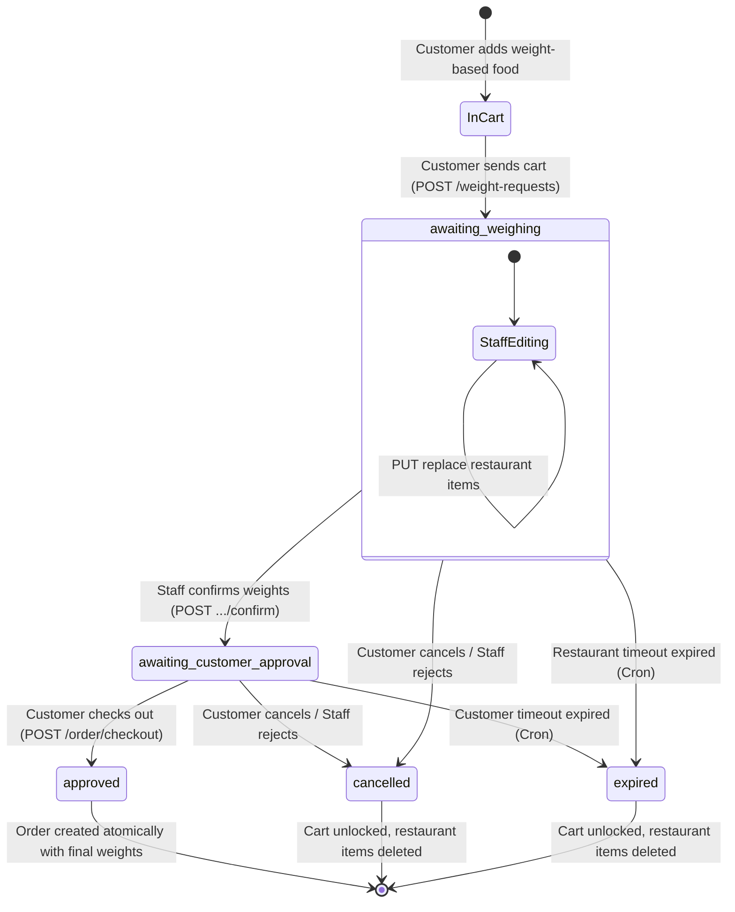

# Weight-Based Food Ordering & Weighing System

## 1. Overview & Architecture

The weight-based food selling system implements a **Cart-First** architecture:
- Items sold by weight (`sold_by = 'weight'`) require weighing by the restaurant staff before payment.
- The weighing state lives strictly in the customer's cart via the `weight_requests` table and locked `cart_items` (`cart_items.weight_request_id`).
- **No orders or payment sessions are created** until the restaurant confirms actual weights, the customer reviews them, and triggers checkout.
- The **checkout call itself IS the approval** (no separate approve endpoint). It builds the order from final weights in one atomic transaction, marks the request `approved`, assigns `order_id`, and clears the cart.

---

## 2. Status Lifecycle & State Diagram

---

## 3. Order-Creation Protection & Gating

All order-creation pathways are protected against unauthorized weight-based food ordering:

1. **Customer Checkout (`POST /order/checkout`)**:
   - Unit-only carts checkout normally as before.
   - Carts with weighted items (`food.sold_by = 'weight'` or `cart_item.weight != null`) are **strictly blocked** with `BadRequest("Cart contains weight-based items. Please send the order to the restaurant for weighing first.")` unless checkout is executed against a request in `awaiting_customer_approval` belonging to this user and not expired.
   - Inside the order transaction, row-level locking (`SELECT ... FOR UPDATE`) guarantees strict idempotency: a double-click checkout cannot create two orders.
   - Items marked `isUnavailable = true` during restaurant weighing are excluded from order creation.
2. **Staff Points Redemption Orders (`POST /admin/points-orders/approve`)**:
   - Both `getOrderByRedeemCode` and `approveRedeemCode` reject foods where `food.sold_by = 'weight'` with `BadRequest("Weight-based foods cannot be redeemed via points orders.")`.
3. **No Alternative Order Paths**:
   - Direct buy-now, scheduled orders, or subscriptions routes do not bypass the cart/checkout pipeline.

---

## 4. API Endpoints

### 4.1 Customer App (`Keeto_SuperAdmin_User`)

| Method | Endpoint | Description |
|---|---|---|
| `GET` | `/cart` | Returns cart items with `requiresWeighing`, `canCheckout`, `isEstimatedTotal`, `weightRequest: { id, status, expiresAt }`, and item `addedBy`. |
| `POST` | `/cart/items` | Adds unit or weight-based food with `weight` and option `price_mode`. Blocked if cart items are locked. |
| `PUT` | `/cart/items/:id` | Updates cart line quantity/weight. Blocked if item is locked to an active weight request. |
| `POST` | `/weight-requests` | Acquires transaction lock (`FOR UPDATE`) on cart items, enforces at most one active request per user+restaurant, locks cart items, sets restaurant expiry timeout. |
| `GET` | `/weight-requests/:id` | Returns request status, expiry, items with `orderedWeight` vs `finalWeight`, `addedBy`, totals, and `weightChanged`. |
| `POST` | `/weight-requests/:id/cancel` | Cancels request, unlocks and resets customer cart items (`final_weight = null`, `is_unavailable = false`), and deletes restaurant-added items. |
| `POST` | `/order/checkout` | Validates approval, builds order using final weights in one atomic transaction, marks request `approved`, and clears cart. |

### 4.2 Restaurant Admin (`Keeto_Restaurant_User`)

All endpoints are scoped to staff's `restaurantId` (and `branchId` when applicable) with `hasPermission("order", "read"|"update", true)`.

| Method | Endpoint | Description |
|---|---|---|
| `GET` | `/admin/weight-requests` | Paginated list of weight requests filtered by status and branch. |
| `GET` | `/admin/weight-requests/:id` | Full request details with customer info, all items, and live recomputed totals. |
| `PATCH` | `/admin/weight-requests/:id/items/:cartItemId` | Modifies `finalWeight` or marks `unavailable` for a customer-owned item (`added_by = 'customer'`). Allowed only while `awaiting_weighing`. Enforces `finalWeight <= orderedWeight * (1 + maxIncrease/100)`. |
| `PUT` | `/admin/weight-requests/:id/items` | **One route** that replaces the full set of restaurant-added items. Mirrors customer cart payload shape. New items added (`added_by = 'restaurant'`), existing items updated, omitted items deleted, empty array deletes all restaurant items. Customer items are untouched. |
| `POST` | `/admin/weight-requests/:id/confirm` | One-time action sending request to customer. Validates all customer items are weighed or unavailable. Writes `weighing_log` JSON, sets customer expiry timeout, status `awaiting_customer_approval`, and notifies customer (Socket + FCM). |
| `POST` | `/admin/weight-requests/:id/reject` | Cancels request with reason, unlocks customer items, deletes restaurant items, and notifies customer. |

---

## 5. Pricing & Math Formula

Variation options support:
- `price_mode = 'fixed'`: flat extra per cart line.
- `price_mode = 'per_weight'`: price is per weight unit (`weight * additional_price`). Allowed only on foods sold by weight.

Formula:
$$\text{line\_total} = \text{weight} \times \text{food\_unit\_price} + \sum(\text{fixed extras}) + \sum(\text{weight} \times \text{per\_weight extras})$$

After restaurant weighing:
$$\text{final\_line\_total} = \text{final\_weight} \times \text{food\_unit\_price} + \sum(\text{fixed extras}) + \sum(\text{final\_weight} \times \text{per\_weight extras})$$

All monetary calculations use scaled integer arithmetic in `src/helpers/weightPricing.helper.ts` avoiding floating-point inaccuracy.

---

### 5.1 Weight groups and custom weight

- `food.allow_custom_weight` (default `true`): may the customer type any weight? Weighted foods only.
- `food_variations.is_weight_group`: the preset weights of a weighted food (e.g. 250 g / 500 g / 1 kg).
  At most ONE per food, single-select, only on foods sold by weight. It is required exactly when
  `allow_custom_weight = false` (stored as `is_required = !allow_custom_weight`).
- `variation_options.weight_value` (decimal(10,3), in the food's `weight_unit`): required (> 0, unique)
  on weight-group options; must be empty on normal options.
- Cart rule (`validateWeightInput`): a selected weight option → `weight` must equal its `weight_value`
  (exact thousandths comparison, never float equality); no weight option → allowed only when
  `allow_custom_weight = true`. The restaurant's final (measured) weight is not checked against the options.
- A weight option's price is an OPTIONAL extra fee (`fixed` or `per_weight`), normally 0. The weight itself
  is always priced as `weight × unit price`.
- A fixed-amount discount is rejected on foods sold per gram (`weight_unit = gm`), because it is applied per
  weight unit. Percentage discounts are allowed for both units; fixed discounts stay allowed for kg foods.

## 6. Background Expiry Cron

- File: `Keeto_Restaurant_User/src/services/weightRequestCron.ts`
- Schedule: Runs every minute (`* * * * *`).
- Target: Requests in `awaiting_weighing` or `awaiting_customer_approval` where `expires_at < NOW()`.
- Action: Atomically sets status to `expired`, deletes restaurant-added items, and unlocks/resets customer cart items.
